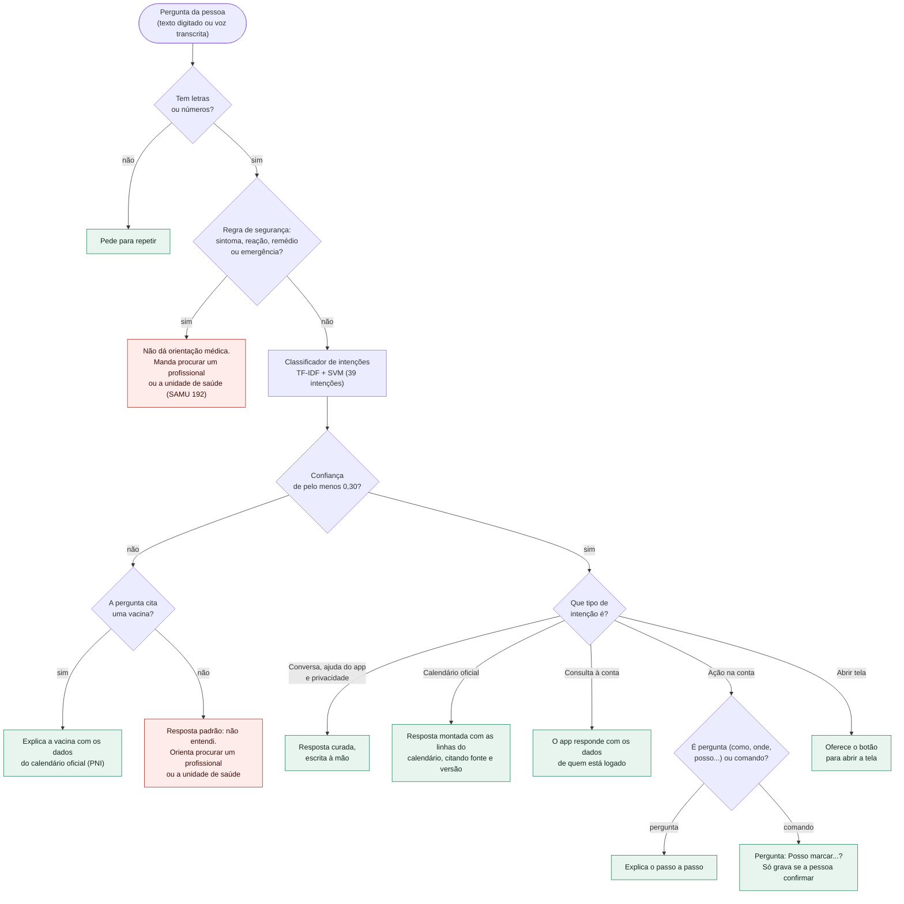
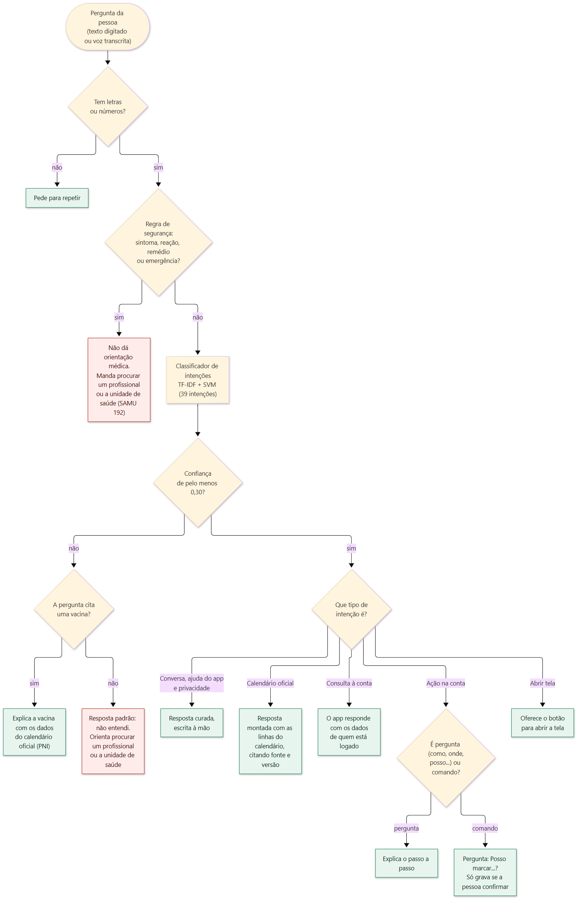

# Árvore de decisão do chatbot (RF07)

Atividade prática da aula "ChatBot I" (Processamento de Linguagem Natural): escolher a funcionalidade em que o chatbot entra e desenhar a árvore de decisão dela.

- **Funcionalidade escolhida:** tirar dúvidas sobre vacinas e sobre o uso do app. O assistente também consulta a conta de quem está logado e executa comandos (adicionar pessoa, registrar e agendar dose), sempre com confirmação (`docs/11-assistente-pln.md`).
- **Tipo de chatbot:** híbrido. **Regras** (árvore de decisão) onde o erro é grave ou a resposta tem que ser sempre a mesma, e **PLN** (TF-IDF + SVM) onde a pessoa escreve ou fala de forma livre. **Sem IA generativa.**
- **Fonte do diagrama:** o código, em `apps/nlp/vacina_nlp/chatbot.py` (`Chatbot.reply` e `_command_or_howto`) e `safety.py`. O desenho segue a ordem em que o código decide; se o código mudar, o diagrama muda junto.

Versão em imagem (para os PDFs de documentação): `arvore-decisao-chatbot.png` e `arvore-decisao-chatbot.svg`.

## Como ler

| Nó | O que decide | Onde está no código |
|---|---|---|
| Letras ou números | Texto vazio ou só símbolos pede para repetir | `Chatbot.reply`, primeiro `if` |
| Regra de segurança | Sintoma, reação, remédio e emergência nunca chegam ao modelo | `safety.needs_professional` |
| Confiança de 0,30 | Abaixo disso a pergunta é tratada como "não entendi" (limiar definido na avaliação, `docs/07-testes/avaliacao-chatbot.md`) | `CONFIDENCE_THRESHOLD` |
| Cita uma vacina | Pergunta curta como "febre amarela é para que" ainda é respondida | `extract_vaccines` |
| Tipo de intenção | Decide quem monta a resposta: texto curado, calendário oficial ou o app com os dados da conta | `Chatbot.reply` e `_for_the_app` |
| Pergunta ou comando | "Como adiciono uma pessoa?" explica; "adicionar a Maria nascida em..." vira comando com confirmação | `Chatbot._command_or_howto` |

## Por que a ordem é essa

1. **Segurança antes do modelo:** um classificador pode errar; uma regra de palavras não erra na mesma pergunta. Orientação médica é o erro mais caro, então é o primeiro desvio.
2. **Limiar antes da resposta:** é melhor dizer "não entendi" e orientar a procurar um profissional do que responder errado sobre saúde.
3. **Resposta sempre curada:** nada é gerado; a fonte e a versão do calendário aparecem nas respostas sobre vacinas.
4. **Ação só com confirmação:** o comando mostra o que vai fazer e só grava depois do "Confirmar", pelas mesmas regras da máquina de estados da dose.

## Limites

- O diagrama mostra as decisões do serviço de PLN. A execução do comando e a leitura dos dados da conta acontecem no app (`apps/mobile/src/lib/assistente-conta.ts`); nada da conta passa pelo serviço de PLN (ADR-025).
- As intenções são agrupadas em cinco tipos para caber no desenho; a lista completa das 39 está em `docs/11-assistente-pln.md`.
- O dataset e as respostas ainda aguardam a revisão do autor (ver `docs/11`).
